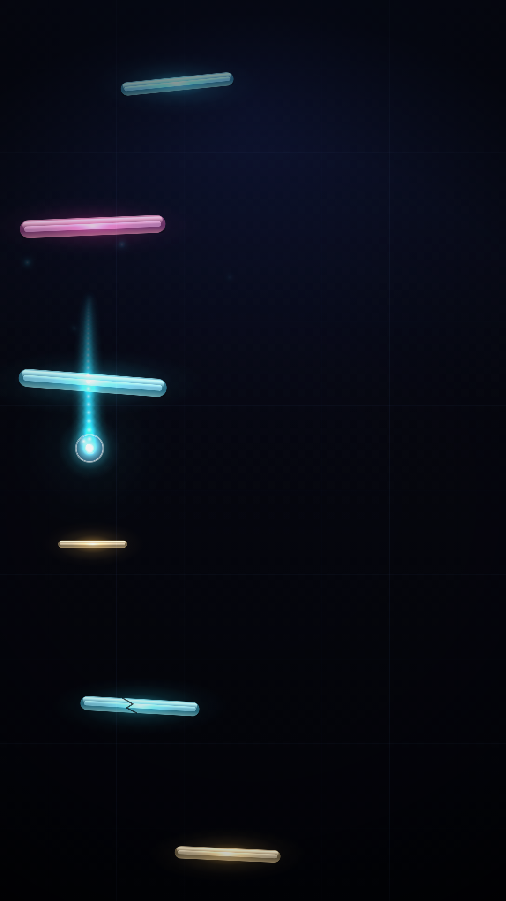

# Music Ball

把一首歌变成「球踩在鼓点上、逐级撞板下落」的霓虹动画，并导出 1080×1920 或 720×1280 / 60fps、≤80MB 的 mp4。

[](https://www.typescriptlang.org/)
[](https://vite.dev/)
[](https://mediabunny.dev)
[](#实测数据)

纯前端：音频分析、渲染、导出全部在浏览器里完成，**没有任何后端**。



## 特性

- **拍点精确到 2.2ms** —— 球在每个拍点时刻必然精确落在板上，误差是 60fps 一帧的 1/8；
  seek 到任意时刻的画面与顺序播放完全一致。
- **钢琴独奏音符驱动** —— basic-pitch 给音符/和弦，宽频 onset 精修模型时刻；
  板子落在音符起音上，切分、装饰音、自由速度都能跟住。
- **真实音乐可用** —— 用 6 首流行歌实测，拍点规律度 86–100%（合成曲 100% 对拍）。
- **玻璃珠是所有歌的默认运动** —— 音符歌用**表面节奏**选点（三连音/切分也能跟）+ 自然滚动；鼓组/流行用约 1s 抽稀的真实拍点。球在板上滚动、掉边、自由落体到下一块板，板提前存在、落点左右/中心自由。
- **经典物理轨迹（手动回退）** —— 纵向是严格的匀加速抛物线，横向由反射定律 + steering 反解倾角烘焙而成；参数面板「运动」可随时切回。
- **玻璃质感** —— 球与板子都是玻璃材质，每次撞击按音乐节奏发出玻璃敲击声。
- **玻璃音轨** —— 音色用 modal synthesis 手写（不谐和振动模态），音高跟随主旋律；
  浏览器默认播放原曲，切到「玻璃声」时现场生成并显示状态；导出音频三选一：玻璃声 / 玻璃+原曲 / 原曲。
- **全本地导出** —— WebCodecs + mediabunny 硬件编码，3 分钟的歌约 1–3 分钟出片；默认分享档 ≤80MB。

## 快速开始

```bash
npm install
npm run dev        # → http://localhost:5273
```

把 mp3 拖进去，空格播放/暂停，点「导出 MP4」。

浏览器要求：**Chrome / Edge 94+** 或 **Safari 26+**（导出需要 `AudioEncoder`）。
Firefox 暂不支持导出。

## 它是怎么做到「踩在拍子上」的

普通做法是「物理引擎模拟 → 看球什么时候落地 → 把板子放在落点」。这个方向是反的：
靠调 `restitution` 永远碰不准拍子，而且掉帧就会失步。

这里反过来：**先由音乐决定落点时刻，再反解运动**。

每一段（两次撞板之间）是一条闭式抛物线：

```
y(s) = y₀ + Δy·(s/Δt) + ½·g·s·(s−Δt)
```

`s=0` 严格等于 `y₀`，`s=Δt` 严格等于 `y₀+Δy` —— 这是恒等式，**与 g 取什么值无关**。
所以球在拍点时刻必然精确落在板上，误差为 0；`g` 可以随便平滑、`Δt` 可以随便变
（变速歌曲天然支持），落点都不受影响。

弹跳高度同样是一个独立参数：给定 `Δt`、`Δy` 和目标高度 `h`，反解重力

```
g = 2·(√h + √(h+Δy))² / Δt²
```

它严格给出起跳速度 `vy(0) = −√(2gh)`、撞击速度 `vy(Δt) = +√(2g(Δy+h))`，
恢复系数 `e = √(h/(h+Δy)) < 1` —— 永远不可能越弹越快。
弱拍贴着板掠过，重拍高高弹起，落点仍然精确。

相机是拍点 y 值的**分段线性插值**（抛物线两端点的弦）：撞击帧球严格停在屏幕 58% 线上，
特效、粒子、震屏全部以同一个绝对坐标为基准，结构上不可能错位。

### 没有鼓的钢琴怎么办

钢琴独奏没有稳定鼓组，拍网格会把切分、装饰音、自由速度抹平。音符驱动模式改为：

- basic-pitch 给出音符/和弦；宽频 onset 把起点精修到真实起音（模型在重叠音/长音上会提前 60–80ms）
- 板子落在（和弦）起音上；拍网格只负责小节相位、强弱与特殊板
- 主导音高取和弦最高音并折回 C4–C6；>24 半音跳变按模型错误忽略，12–24 半音做 tanh 压缩
- 快速跑动按「合并、优先强起音」处理；长音/休止用幽灵板维持运动，不补假板
- 自动判定看高频瞬态占比：钢琴 0.04–0.06 走音符，流行/鼓组 0.11–0.26 走网格；检测到鼓组优先网格
- 模型不可用或音符不足时回退网格并明确提示，不拿 0.1s 帧移的 FFT 旋律当时间基准
- **运动与撞点解耦**：所有歌默认玻璃珠；网格/鼓组用约 1s 抽稀的真实拍点，音符歌用音符起音
- 音符提取完成或缓存命中后，在撞击点用 0.2–0.3s 过渡自动升级为音符玻璃珠；经典运动或无可用撞击点时暂停/seek 再应用
- 网格玻璃珠没有真实音高：板色按鼓组频段、宽度/弹跳按拍强映射

模型路径的音符级同步仍只承诺**纯钢琴独奏**；网格/鼓组玻璃珠只承诺踩在真实拍点上，不承诺音符级同步。

## 音频分析（纯前端）

跑在 Web Worker 里，一首 3 分钟的歌约 2 秒：

```
STFT (N=1024, hop=256, +N/2 窗中心补偿)
  → 三频段（20–200 / 200–2k / 2k–8k）正向谱通量，log1p 压缩 + 局部均值白化
  → 自适应阈值峰值拾取（局部均值 + 1.2σ，抛物线亚帧细化）
  → 自相关估周期（对数正态先验压半速/倍速歧义）
  → Ellis 动态规划拍点跟踪（不是全局网格 + 吸附 —— 后者 1% 的速度误差
     在 50 秒后就偏 0.25 秒）
  → 低频 onset 链（低通 120Hz + 包络差分）—— STFT 的低频段在 N=1024 下
     只有 4 个 bin，不可用
  → 网格正则 + 小窗吸附（截尾均值估周期 + 锁相环相位跟踪 + ±40ms 吸附到真实鼓点）
```

节拍链零模型依赖。音符驱动另走 basic-pitch（Worker 内 WebGL 优先、CPU 回退，结果持久缓存）提取旋律/和弦，
再用宽频 onset 精修每个音符的起点；降级到 FFT 主峰时只用于音高，不作为时间基准。

## 旋律提取 Worker

basic-pitch 模型推理在专用 Web Worker，主线程只做 22.05kHz 重采样、onset 精修和结果应用：

- Worker 内优先 WebGL（OffscreenCanvas）；tfjs 3.21 的 `PlatformBrowser.setTimeoutCustom` 在 Worker 里引用 `window`，用一次小兼容补丁绕过。WebGL 不可用/失败时回退 CPU，提示可见。
- 168.5s 真实钢琴：headless Chromium 实测 **CPU 90.0s → WebGL 15–21s**；同曲再次加载走 IndexedDB 缓存，**约 0.2–1.0s** 直接出音符（只跑分析）。真机硬件 WebGL 需再做一次对照。
- 缓存键 = 文件内容 SHA-256 + 模型/参数版本；每首约 0.1–0.5MB，上限 50 首/30MB，LRU 淘汰。缓存不可用/配额不足/条目损坏时正常提取，不阻塞播放。
- 提取期间可播放、拖 seek、调参数、换歌或点“取消旋律提取”；文件选择不再被长时间锁住。
- 音符就绪且自动判定为音符时，在撞击点用 0.2–0.3s 交叉过渡切到音符玻璃珠，不重启音频；经典运动或无可用撞击点时暂停/seek 再应用。
- 模型/Worker 失败回退 FFT 旋律，自动模式回网格，提示可见。
- 主线程帧间隔目标 <200ms；玻璃整轨渲染仍是独立的性能点，不在 Worker 范围内。

第三步起是针对**真实音乐**的关键：混音后的流行歌 onset 遍地都是（人声、弦乐、踩镲），
裸 DP 的拍链会沿着「最近响一下」滑出网格。实测规律度 52–93%，网格正则后 86–100%。

## 物理烘焙

纵向是运动学的（恒等式保证落点），横向用**反射定律**烘焙：

```
板法线 n = (sinθ, −cosθ)，v' = v − 2(v·n)n，法向分量乘恢复系数 e
vx' = vxIn·(cos²θ − e·sin²θ) + vyImp·(1+e)·sinθ·cosθ
```

关键：倾角**不能**直接取「球的路径角」。纯物理的反射会把球甩出赛道 ——
撞击速度 ≈ 4.45× 本段速度，θ=16° 时半个拍间隔就横移 613 世界单位，而赛道半宽只有 307。
所以倾角由「本拍想横移多少」**反解**（`solveTilt` 二分 40 次，完全确定），
物理负责让这一下看起来像真的，目标位置由音乐节奏决定。

烘焙输出结点表（knot）与每块板的倾角。当前运行时 `evalBall` 用三次 Hermite 求值：
u=0/1 严格落在板上，段边界速度连续；结点表保留给后续物理后端（撞墙折点尚未接入求值）。
matter.js 可以作为同一契约下的可插后端，但在这套「y 运动学强驱 + 瞬时接触」的架构里
它能算的只有同一个公式，所以默认不开。

## 玻璃珠运动（所有节奏来源默认）

任意歌默认不再走“球钉在 58%、背景滚”的经典运动。音符歌与网格歌使用不同的玻璃珠几何：

### 音符驱动：表面节奏 + 自然滚动

- **撞点来源**：音符板起音（不是拍点）。候选包括正拍、切分和三连音细分；按 onset 强度、
  力度、节拍位置（1/3、2/3 细分权重 0.75）、低音与音高变化打分，再按目标密度 1.2 次/秒、
  最短间隔 0.5s 选点，超过 1.8s 的空隙按最高分补点。
- **滚动段**：球沿板从撞击高边滚向低边，时长 0.26–0.75s（按撞击间隔），
  球内偏心内含物按弧长/半径旋转，滚而不是滑过。
- **掉落段**：离开板边后按确定性抛物线自由落体到下一块板，板距由撞击间隔反解。
- **落点自由**：板 x 由音高轮廓决定，左右/中心都可落；不强制交替。
- **板子提前存在**：不滑入；镜头对球 y 做 ~0.28s 低通跟随，锚点屏幕 54%，
  首板撞击前钉在首板，长前奏不会把板子推出画面。
- **提取期轻量预览**：旋律提取 Worker 运行期间，预览降到 540×960 内部分辨率并跳过
  尾迹/板外辉光（drawImage 34→7 次/帧）；提取完成、取消或失败后立即恢复 720×1280 全量渲染。
  只影响预览，不影响导出与音频。
- **静态舞台层**：预览的背景/暗角只在启动时绘制一次，动态画布只画运动内容；
  每帧全屏填充 1.98Mpx→0.29Mpx（−85%）。导出仍在单帧内绘制完整背景与暗角。
- **音符升级**：钢琴/器乐先拍点玻璃珠，音符提取或缓存就绪后在撞击点用 0.2–0.3s
  过渡切到自然滚动；经典运动/无可用撞击点时退回暂停/seek 应用。

### 网格/鼓组：拍点玻璃珠

- **撞点来源**：真实拍点，按约 1s 抽稀（慢歌逐拍、120BPM 隔一拍、快歌隔两拍），优先强拍。
- **严格左右交替**：球沿板从外侧高点滚向中心低点（0.45–0.75s），掉边后自由落体到对侧板；
  撞击帧相机把球放在屏幕 58%，下一块板在下落段从对应侧滑入。
- **网格没有音高**：板色按鼓组频段（kick/snare/hat）映射，宽度/弹跳按拍强；不跑 FFT 取音高。

参数面板的「运动」可切经典做对照/回退。玻璃珠撞击点同时驱动玻璃音轨的时间、音高、力度与声像。

## 音乐驱动的下落速度与停顿

以前 V 是常量。现在每一段：

```
V = 基础速度 × BPM 因子 × 活跃度因子 × 长段落因子
Δy = V · Δt
g 仍由本段 h / Δt 反解
```

- **BPM 因子**：快歌整体更快、慢歌更慢（约 0.7–1.5×）。
- **活跃度**：每段后 75% 的谱通量均值（全曲 p90 归一化）与音符力度融合。
  密集/响段滚得快，安静段慢；长音/休止只减速，不硬停。
- **长段落因子**：按「距下一个真实板的原始间隔」减速 —— 长休止会被切成 ghost 段，
  不能只看单段 Δt。
- **弹跳**：高度融合音频活跃度与音符力度；强段/强音更高，弱段/长音更低。
- **变化幅度**：0% = 恒定 V / 统一弹跳 / 无特殊板；100% = 最大跟随；默认 70%
  有效 V 约 0.6–1.6× 基础速度。
- **`Δy = V·Δt` 的恒等式不变**：落点仍严格精确；相机锚点、横向烘焙、撞击时刻都不动。

「下落速度」滑杆是**基础速度**，不是最终速度。经典运动也应用这套映射；把变化幅度拉到 0
可以回到旧匀速观感。玻璃珠运动不使用 V，而是按滚动/掉落固定时长表演。

## 玻璃音轨

- **音色**：modal synthesis 手写 —— 玻璃的敲击声本质是若干**不谐和**振动模态的叠加
  （1 : 1.59 : 2.14 : 2.65 : 3.32 : 4.5 : 5.7，±0.2% 微失谐），余音 0.6–1.6s，
  高次模态衰减更快，再加高通噪声起音 + shimmer 与软限幅。不引 Tone.js（~150KB，
  且它的 Transport 模型和闭式求值冲突）。浏览器与 CLI 共用 `glass-recipe.ts` 的参数。
  浏览器用 `OfflineAudioContext` 离线渲染；命令行出片在
  `glass-node.ts` 里用纯 JS 叠样本实现**同一套参数/音色**（WebAudio 与纯 JS 的滤波/声像实现略有差异）。
- **音高**：`@spotify/basic-pitch`（Apache-2.0，模型约 1MB）提取主旋律，玻璃声按音高演奏；
  模型加载失败自动降级为每拍 FFT 主峰，两条路径产出同构。
- **渲染**：`OfflineAudioContext`（48kHz 单声道）一次离线渲染整条音轨成 AudioBuffer，
  预览与导出播同一份 —— 所听即所得。
- **声像**：跟随球的横向位置。

导出音频三选一：**玻璃声 / 玻璃+原曲 / 原曲**。浏览器加载后默认原曲；切到玻璃声时现场生成，
生成期间界面显示「玻璃音轨生成中…」，完成后无缝换轨。旧渲染请求会被序号丢弃，不会覆盖新音轨。

## 导出

浏览器内 `WebCodecs + mediabunny` 完成，不上传任何数据。

**分享档（默认，不提供画质选项）**：任何时长都 ≤80MB。视频码率按曲长反算
（`(76MB − 音频) × 8 / 时长`，上限 3.2 Mbps）；反算码率 ≥2.0 Mbps 用 1080×1920@60，
否则用 720×1280@60；AAC 192k，始终 60fps。3 分钟约 76MB，4 分钟保持 1080p，
约 4 分 40 秒以上自动 720p。按钮会显示实际导出分辨率。浏览器用目标码率 VBR；
Node 出片用 CRF 20 + `maxrate` 的 VBV 上限，两条路径都不再产生 100MB+ 的默认产物。

三个容易踩的坑都已处理：

- **`avc1.64002a` 而不是 `avc1.640028`**：Level 4.0 的 MaxMBPS 是 245760，
  1080×1920@60 需要 489600，用 4.0 会被直接拒绝。代码里按宏块率自动选级别。
- **AAC 编码器的 priming 必须补偿**：封装库不写 MP4 的 edit list，编码器在码流前塞的
  1024–2112 个采样会让整条音轨延后 40–50ms（60fps 下 2–3 帧，肉眼可见）。
  代码用「第 0 个采样就是脉冲」的探针走同一条编码链路，解码回来量出真实延迟再让视频跟着偏。
- **长时间线用 `StreamTarget` 直写磁盘**，否则一首全曲约 70–80MB 全放内存，finalize 时翻倍。

## 实测数据

合成测试曲（`npm run testtrack` 生成，已知标准答案）：

| 测试曲 | 对拍 | 中位误差 |
|---|---|---|
| 稳态 120BPM | 120/120 | 2.2ms |
| 8 秒空当前奏 128BPM | 95/96 | 2.1ms |
| 中途变速 100→140 | 100/105 | 2.2ms |
| 3/4 拍 150BPM | 120/120 | 1.7ms |

真实音乐（`fixtures/real/`，6 首 1997 年国语流行，无人工真值）：

| 曲目 | 修复前规律度 | 修复后 |
|---|---|---|
| 快乐老家 | 72% | 96% |
| 知心爱人 | 52% | 92% |
| 阳光总在风雨后 | 67% | 94% |
| 第三只眼 | 61% | 87% |
| BAD BOY | 88% | 100% |
| 爱的初体验 | 93% | 100% |

`规律度` = 拍间隔落在中位数 ±15% 内的比例。60fps 一帧是 16.7ms。

玻璃珠运动（真实钢琴全曲，表面节奏 + 自然滚动）：

| 项目 | 实测 |
|---|---|
| 全曲 | 168.5s / 5939 个模型音符 / **约 206 次撞击**，中位间隔 0.560s、最大 1.686s |
| 拍点规律度 | 0.967（钢琴 DP 规整惩罚 1.5，1.25×/1.5×/1.75× 间隔 3.7%） |
| 首次提取 | WebGL 约 11–12s（快速 Melodia；原版 14.5s）；CPU 回退约 90s（headless Chromium） |
| 提取后处理 | `outputToNotesPoly` 5.4s → 约 1s（本地行最大值堆；真实钢琴高负载 1.07s、隔离基准 75ms；5939 音符与原库逐条一致） |
| 缓存命中加载 | 0.62–1.01s（同曲再次加载，只跑分析、不启动 Worker） |
| WebGL vs CPU 音符 | 两条后端历史验证逐条一致；piano-90 的 1147 个也一致 |
| 网格玻璃珠（steady-120） | 61 次撞击，间隔中位 0.999s，最大 1.028s |
| 音符升级过渡 | 0.26s 交叉；提取/过渡期间帧间隔 p95 17.5ms，max 32.8ms |
| 浏览器导出（10s 鼓组玻璃珠） | 10.1s / 603 帧，成功（旧 10Mbps 基线，耗时 22.2s） |
| 预览帧间隔（播放中） | 平均 16.6ms，p95 16.7ms，max 16.8ms |
| 撞击帧位置 | 自然滚动锚点屏幕 54%，拍点玻璃珠 58%（脚本断言 + 抽样截图） |
| 提取期轻量预览 | 内部分辨率 540×960（0.56× 像素），drawImage 7 vs 34 次/帧；提取结束恢复 720×1280 |
| 预览静态层 | 每帧全屏填充 1.98Mpx→0.29Mpx（−85%）；暗角/背景逐像素平均差 0.35/255，导出路径不变 |
| 全曲浏览器导出 | 168.576s，1080×1920@60fps，70.6MB，成功下载（2026-11-03 分享档；旧 10Mbps 基线 118MB） |
| Node 全曲分享档 | 真实钢琴 168.5s，1080×1920@60fps，34.0MB（旧 CRF17 50MB）；20s 段 VMAF 96.7、最低 94.8 |
| 5 分钟曲自动 720p | 298.2s → 720×1280@60fps，1.85Mbps，预计 76MB |
| 玻璃音轨 | 约 206 个撞击音；切回经典后按 681 块板重算 |
| 经典回退 | 手动可切；网格歌曲也默认可选玻璃珠 |


音符驱动（表达性钢琴 fixture，真值音符直接入图）：

| 用例 | 事件对齐 | 简单段召回 | 力度相关 |
|---|---|---|---|
| 切分 / 装饰音 / rubato / 长音 / 休止（真值音符直接入图） | median 0.0ms，p90 0.0ms | 100% | ρ(amp,h)=0.88 |
| 浏览器 basic-pitch + 音频起音精修 | 匹配板 median 1.2ms，p90 2.0ms | 97.9% | — |

浏览器模型路径 65 块板中 54 块落在真值起音 50ms 内；11 块是长音/和弦的模型谐波多检，
其中 4 秒长音持续段 5 块、2 秒休止段 0 块。自动判定：钢琴 `highRatio=0.057` → 音符；
5 首流行 `0.11–0.17` → 网格。

## 脚本

```bash
npm run dev         # 开发服务器
npm run build       # 生产构建
npm run typecheck   # tsc --noEmit
npm run testtrack   # 生成 4 首「已知标准答案」的鼓组合成测试曲
npm run pianotrack  # 生成钢琴测试曲（piano-90 + 表达性钢琴）
npm run verify      # 鼓组/网格回归：拍点精度 / 落点精度 / 规律度 / NaN
npm run verify:note # 音符驱动回归：事件对齐 / 力度 / 音高 / 静音段 / 自动判定
npm run verify:note:real  # 同上，额外跑 fixtures/real 本地素材（不入库）
npm run verify:speed      # 速度跟随：活跃度相关 / BPM / 长段减速 / 平滑 / drama=0
npm run verify:bead       # 拍点玻璃珠：对拍 / 左右交替 / 滚动掉落 / 相机 / 板入场 / 拍点抽稀
npm run verify:natural    # 自然滚动：覆盖整曲 / 连续性 / 镜头舒适区 / 音高轮廓 / 可复现 / 防呆
npm run verify:scene      # 场景选择：音符→自然滚动，网格→拍点玻璃珠，经典回退
npm run verify:cache      # 旋律缓存键/哈希/Node 降级/淘汰
npm run verify:export     # 分享档：≤80MB、1080p/720p 切换点、始终 60fps

# 不开浏览器、直接用 Node 出片（需系统装 ffmpeg；音轨默认玻璃声，可 --audio=glass|mix|original）
node --experimental-strip-types scripts/render-video.mts <输入> <输出.mp4>
#   默认分享档：按曲长自动 1080×1920@60 / 720×1280@60，压到 ≤80MB
#   --stills=1.2,3.4   只导出静帧（调视觉用）
#   --seconds=20       只渲染前 20 秒
#   --scale=0.5        调试分辨率（同时回到 CRF17）
#   --motion=auto|bead 有 --notes 时走表面节奏 + 自然滚动；无音符时用抽稀拍点玻璃珠
#   --notes=out/acceptance/real-notes2.json  用真实钢琴音符出片
#   --motion=classic   经典运动（手动对照/回退）
```

Node 出片与浏览器导出共用同一个 `drawScene()` —— 这是把渲染写成 `render(t)` 纯函数的收益。

## 目录结构

```
src/
  types.ts              全部共享类型（零 DOM 依赖，Node 里能直接跑）
  util/                 math / prng（确定性哈希与种子随机）
  analysis/
    fft.ts              radix-2 FFT + Hann 窗
    onset.ts            三频段谱通量 + 自适应峰值拾取
    tempo.ts            自相关 + 对数正态先验
    beats.ts            Ellis DP 拍点跟踪
    lowband.ts          低通 + 包络差分的低频 onset 链
    grid.ts             网格正则 + 小窗吸附（锁相环）
    melody.ts           主旋律提取（basic-pitch + FFT 降级 + 音频 onset 精修）
    rhythm-mode.ts      音符/网格的纯判定（鼓组优先 + 模型来源守卫）
    melody-model.ts     basic-pitch 模型推理（Worker 导入）
    melody.worker.ts    旋律提取 Web Worker（WebGL 优先 / CPU 回退）
    melody-client.ts    Worker 创建/进度/取消/结果
    melody-cache.ts     IndexedDB 旋律缓存（内容哈希 + 模型版本 + LRU）
    pipeline.ts         完整流水线（纯同步函数）
    worker.ts/client.ts Worker 封装
  chart/
    build.ts            拍点 → 运动学图表（合并/细分/预卷/扫掠/特殊板）
    speed.ts            音乐驱动速度（谱通量活跃度 / BPM / 长段减速）
    bead.ts             拍点玻璃珠路径（撞击抽稀/滚动/掉落/相机/板入场）
    natural.ts          自然滚动路径（自由落点/预置板/低通镜头）
    salience.ts         表面节奏选点（音符板候选 + 节拍权重 + 密度/间隔 DP）
    scene.ts            场景选择（音符→自然滚动；网格→拍点玻璃珠；经典回退）
    notes.ts            音符 → 和弦板（合板、密集合并、力度/主导音高）
    physics.ts          横向反射烘焙（reflectX / solveTilt / knot 表）
    ball.ts             evalBall / evalCamera —— 唯一真相
    styles.ts           板子几何与风格派生（厚度/倾角/小节相位/特殊板）
  render/
    theme.ts            Ctx2D 最小接口 + 调色板 + 世界单位常量
    assets.ts           预烘焙 sprite（glow / 玻璃球 / 玻璃条 / 背景 / 暗角）
    particles.ts        无状态粒子与冲击环
    draw.ts             经典运动 draw(ctx, chart, t, view) 纯函数
    bead.ts             玻璃珠 drawBead + 滚动标记
    scene.ts            drawScene 场景分派
  audio/
    decode.ts           文件 → AudioBuffer + 单声道 PCM（固定 44.1k 解码）
    clock.ts            播放时钟（含输出设备延迟补偿）
    glass.ts            玻璃音轨合成 + 混音
    glass-node.ts       Node 端玻璃合成（CLI 出片用）
  export/
    profile.ts          分享档：按曲长反算码率，1080p/720p 自动切换
    mp4.ts              mediabunny 封装 + 编码延迟自校准
  ui/waveform.ts        波形 + 拍点刻度
  main.ts               界面与状态机

scripts/
  make-testtrack.mts        鼓组合成测试曲
  make-piano.mts            piano-90（小星星 + 分解和弦）
  make-piano-expressive.mts 表达性钢琴（切分/装饰音/rubato/长音/休止/和弦）
  verify.mts                鼓组/网格回归
  verify-note.mts           音符驱动回归
  verify-speed.mts          速度跟随回归
  verify-bead.mts           玻璃珠路径 + 拍点抽稀
  verify-scene.mts          场景选择（玻璃珠/经典/回退）
  verify-cache.mts          旋律缓存键/哈希/降级/淘汰
  render-video.mts          Node 出片
```

## 设计决策与硬性约束

改代码时别破坏这五条，它们是这个项目能「逐帧可复现」的地基：

1. **`draw()` 里不允许出现 `Math.random` / `Date.now` / 每帧新建渐变。**
   粒子、拖尾、玻璃声的微失谐全部由 `hash32(索引, 序号)` 与 `t` 反推 ——
   否则乱序并行渲染会花屏、导出不可复现。
2. **时间只能信 `AudioContext.currentTime`。** `rAF` 只决定「什么时候画」，
   不决定「画第几秒」。
3. **`Δt ≤ 0` 会让 `g` 变 Infinity，进而 NaN 而 Canvas 静默不画（球消失）。**
   `DT_MIN/DT_MAX`、`sanitizeFrames`、`clampBounce` 里的 `Math.max(0, h)` 都是为这个兜底。
4. **`g` 必须由本段的 `Δt` 反解，不能用平滑后的值。** 否则「顶点高度 = h」和
   `vy(0) = −√(2gh)` 两条性质都不成立。要平滑就平滑 `h`，不要平滑 `g`。
5. **速度映射只能改 `Δy`，不能改落点恒等式。** V 逐段可变，但 `Δy = V·Δt` 必须绑定
   本段 `Δt`；`g` 仍由本段 `h/Δt` 反解；`drama=0` 必须回到恒定 V。

## 已知限制

- **导出需要 AAC 编码器**：Chrome/Edge 94+、Safari 26+。Firefox 全平台没有 AAC，
  会给出明确提示（预览不受影响）。
- **音符模型只在浏览器**：CLI 出片没有 basic-pitch；无 `--notes` 时默认经典，`--motion=bead|auto` 可用抽稀拍点玻璃珠。音符级同步仍只承诺**纯钢琴独奏**；网格/鼓组玻璃珠只承诺拍点对齐。
- **首次提取仍需等待**：168.5s 曲目 WebGL 约 11–12s（快速 Melodia；旧 13.5–18.9s），CPU 回退约 90s；同曲二次加载走缓存约 0.6–1.0s。硬件 WebGL 与 headless 软件 WebGL 可能有差异，真机需再对照；不可用/失败时回退 CPU 并提示。
- **网格玻璃珠没有音高**：板色/宽度按鼓组频段和拍强映射，不是旋律音高；需要音高感可手动切音符驱动。
- **超长前奏的有效撞点**：拍点玻璃珠只用真实拍点，首撞前沿用入场掉落；极长空白可能显得悬停，视觉验收中发现再补幽灵拍点。
- **音符升级的过渡**：0.2–0.3s 交叉；若真机观感不通过，退回“暂停/seek 时应用”，并保留音符就绪提示。
- **玻璃珠模式下经典控件固定**：基础速度/板密度/变化幅度/轨迹/物理自由度由撞点决定，控件置灰；切经典可调。
- **basic-pitch 会在长音持续段把谐波识别成新起音**：本轮接受并按实际记录
  （表达性钢琴 4 秒长音内 5 块多检，2 秒休止段 0 块）；后续可用频谱新颖度过滤。
- **横向映射会把 >24 半音的跳变视为模型八度/谐波错误**：该步保持横向，12–24 半音用
  tanh 压缩，避免真实钢琴上的谐波让球在墙之间乱甩。
- **速度跟随是段落级**：活跃度按全曲 p90 归一化，极低 BPM/极长空白会被上下限夹取；
  经典运动的视觉会随活跃度起伏，`变化幅度=0` 可回旧匀速观感。玻璃珠不使用 V，按滚动/掉落固定时长表演。
- **横向烘焙的撞墙折点尚未接入 `evalBall`**：结点表已生成，运行时用三次 Hermite 求值。
- 蓝牙耳机的输出延迟可能超出浏览器报告值，预览侧已自动补偿 + 可用「时间微调」手动校准；
  导出的 mp4 不受播放设备影响。

## 音频与模型来源

- `fixtures/real/` 下的音乐**不入库**（版权），仅作本地测试。
- `fixtures/piano-*.wav` 由 `npm run pianotrack` 生成（wav 不入库，truth JSON 入库）；
  表达性钢琴覆盖切分、装饰音、rubato、长音、休止、强弱与和弦。
- `public/models/basic-pitch/` 由 `predev`/`prebuild` 脚本从
  [`@spotify/basic-pitch`](https://www.npmjs.com/package/@spotify/basic-pitch)（Apache-2.0）复制。
- 依赖：[`mediabunny`](https://mediabunny.dev)（MPL-2.0）、
  [`@mediabunny/aac-encoder`](https://github.com/Vanilagy/mediabunny)（MPL-2.0）、
  [`@spotify/basic-pitch`](https://github.com/spotify/basic-pitch)（Apache-2.0）。
