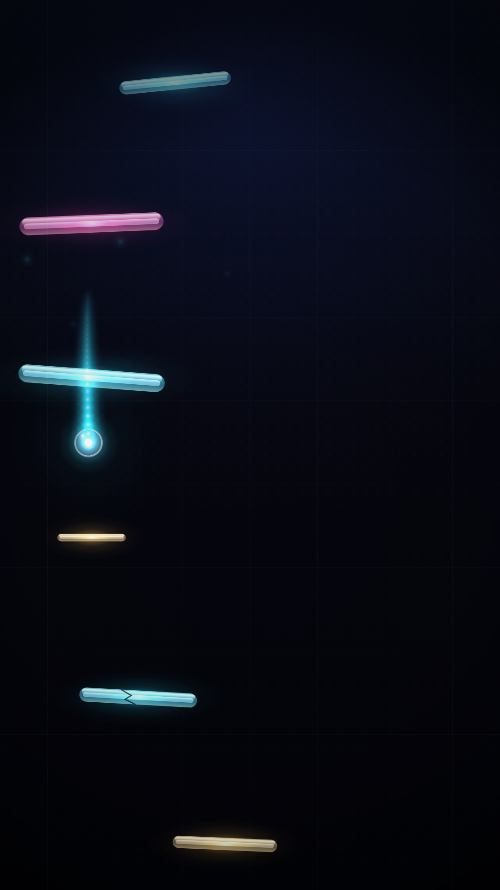

# Music Ball

把一首歌变成「球踩在鼓点上、逐级撞板下落」的霓虹动画，并导出 1080×1920 / 60fps 的 mp4。

[](https://www.typescriptlang.org/)
[](https://vite.dev/)
[](https://mediabunny.dev)
[](#实测数据)

纯前端：音频分析、渲染、导出全部在浏览器里完成，**没有任何后端**。



## 特性

- **拍点精确到 2.2ms** —— 球在每个拍点时刻必然精确落在板上，误差是 60fps 一帧的 1/8；
  seek 到任意时刻的画面与顺序播放完全一致。
- **真实音乐可用** —— 用 6 首流行歌实测，拍点规律度 86–100%（合成曲 100% 对拍）。
- **物理轨迹** —— 纵向是严格的匀加速抛物线，横向由反射定律 + steering 反解倾角烘焙而成。
- **玻璃质感** —— 球与板子都是玻璃材质，每次撞击按音乐节奏发出玻璃敲击声。
- **玻璃音轨** —— 音色用 modal synthesis 手写（不谐和振动模态），音高跟随主旋律；
  导出音频三选一：玻璃声 / 玻璃+原曲 / 原曲。
- **全本地导出** —— WebCodecs + mediabunny 硬件编码，3 分钟的歌约 1–3 分钟出片。

## 快速开始

```bash
npm install
npm run dev        # → http://localhost:5273
```

把 mp3 拖进去，空格播放/暂停，点「导出 MP4」。

浏览器要求：**Chrome / Edge 94+** 或 **Safari 26+**（导出需要 `AudioEncoder`）。
Firefox 暂不支持导出。

## 它是怎么做到「踩在拍子上」的

普通做法是「物理引擎模拟 → 看球什么时候落地 → 把板子放在落点」。这个方向是反的：
靠调 `restitution` 永远碰不准拍子，而且掉帧就会失步。

这里反过来：**先由音乐决定落点时刻，再反解运动**。

每一段（两次撞板之间）是一条闭式抛物线：

```
y(s) = y₀ + Δy·(s/Δt) + ½·g·s·(s−Δt)
```

`s=0` 严格等于 `y₀`，`s=Δt` 严格等于 `y₀+Δy` —— 这是恒等式，**与 g 取什么值无关**。
所以球在拍点时刻必然精确落在板上，误差为 0；`g` 可以随便平滑、`Δt` 可以随便变
（变速歌曲天然支持），落点都不受影响。

弹跳高度同样是一个独立参数：给定 `Δt`、`Δy` 和目标高度 `h`，反解重力

```
g = 2·(√h + √(h+Δy))² / Δt²
```

它严格给出起跳速度 `vy(0) = −√(2gh)`、撞击速度 `vy(Δt) = +√(2g(Δy+h))`，
恢复系数 `e = √(h/(h+Δy)) < 1` —— 永远不可能越弹越快。
弱拍贴着板掠过，重拍高高弹起，落点仍然精确。

相机是拍点 y 值的**分段线性插值**（抛物线两端点的弦）：撞击帧球严格停在屏幕 58% 线上，
特效、粒子、震屏全部以同一个绝对坐标为基准，结构上不可能错位。

## 音频分析（纯前端，零模型依赖）

跑在 Web Worker 里，一首 3 分钟的歌约 2 秒：

```
STFT (N=1024, hop=256, +N/2 窗中心补偿)
  → 三频段（20–200 / 200–2k / 2k–8k）正向谱通量，log1p 压缩 + 局部均值白化
  → 自适应阈值峰值拾取（局部均值 + 1.2σ，抛物线亚帧细化）
  → 自相关估周期（对数正态先验压半速/倍速歧义）
  → Ellis 动态规划拍点跟踪（不是全局网格 + 吸附 —— 后者 1% 的速度误差
     在 50 秒后就偏 0.25 秒）
  → 低频 onset 链（低通 120Hz + 包络差分）—— STFT 的低频段在 N=1024 下
     只有 4 个 bin，不可用
  → 网格正则 + 小窗吸附（截尾均值估周期 + 锁相环相位跟踪 + ±40ms 吸附到真实鼓点）
```

第三步起是针对**真实音乐**的关键：混音后的流行歌 onset 遍地都是（人声、弦乐、踩镲），
裸 DP 的拍链会沿着「最近响一下」滑出网格。实测规律度 52–93%，网格正则后 86–100%。

## 物理烘焙

纵向是运动学的（恒等式保证落点），横向用**反射定律**烘焙：

```
板法线 n = (sinθ, −cosθ)，v' = v − 2(v·n)n，法向分量乘恢复系数 e
vx' = vxIn·(cos²θ − e·sin²θ) + vyImp·(1+e)·sinθ·cosθ
```

关键：倾角**不能**直接取「球的路径角」。纯物理的反射会把球甩出赛道 ——
撞击速度 ≈ 4.45V，θ=16° 时半个拍间隔就横移 613 世界单位，而赛道半宽只有 307。
所以倾角由「本拍想横移多少」**反解**（`solveTilt` 二分 40 次，完全确定），
物理负责让这一下看起来像真的，目标位置由音乐节奏决定。

烘焙输出结点表（knot），运行时 `evalBall` 只查表线性插值 —— 零开销、可 seek、可并行渲染。
matter.js 可以作为同一契约下的可插后端，但在这套「y 运动学强驱 + 瞬时接触」的架构里
它能算的只有同一个公式，所以默认不开。

## 玻璃音轨

- **音色**：modal synthesis 手写 —— 玻璃的敲击声本质是若干**不谐和**振动模态的叠加
  （1 : 1.6 : 2.2 : 2.9 : 3.6，±0.2% 微失谐）加高通噪声 burst，指数包络。
  不引 Tone.js（~150KB，且它的 Transport 模型和闭式求值冲突）。
  浏览器用 `OfflineAudioContext` 离线渲染；命令行出片在
  `glass-node.ts` 里用纯 JS 叠样本实现**同一套配方**（同 seed 同输出）。
- **音高**：`@spotify/basic-pitch`（Apache-2.0，模型约 1MB）提取主旋律，玻璃声按音高演奏；
  模型加载失败自动降级为每拍 FFT 主峰，两条路径产出同构。
- **渲染**：`OfflineAudioContext`（48kHz 单声道）一次离线渲染整条音轨成 AudioBuffer，
  预览与导出播同一份 —— 所听即所得。
- **声像**：跟随球的横向位置。

导出音频三选一：**玻璃声 / 玻璃+原曲 / 原曲**。

## 导出

浏览器内 `WebCodecs + mediabunny` 完成，不上传任何数据。三个容易踩的坑都已处理：

- **`avc1.64002a` 而不是 `avc1.640028`**：Level 4.0 的 MaxMBPS 是 245760，
  1080×1920@60 需要 489600，用 4.0 会被直接拒绝。代码里按宏块率自动选级别。
- **AAC 编码器的 priming 必须补偿**：封装库不写 MP4 的 edit list，编码器在码流前塞的
  1024–2112 个采样会让整条音轨延后 40–50ms（60fps 下 2–3 帧，肉眼可见）。
  代码用「第 0 个采样就是脉冲」的探针走同一条编码链路，解码回来量出真实延迟再让视频跟着偏。
- **长时间线用 `StreamTarget` 直写磁盘**，否则 3 分钟约 200MB 全放内存，finalize 时翻倍。

## 实测数据

合成测试曲（`npm run testtrack` 生成，已知标准答案）：

| 测试曲 | 对拍 | 中位误差 |
|---|---|---|
| 稳态 120BPM | 120/120 | 2.2ms |
| 8 秒空当前奏 128BPM | 95/96 | 2.1ms |
| 中途变速 100→140 | 100/105 | 2.2ms |
| 3/4 拍 150BPM | 120/120 | 1.7ms |

真实音乐（`fixtures/real/`，6 首 1997 年国语流行，无人工真值）：

| 曲目 | 修复前规律度 | 修复后 |
|---|---|---|
| 快乐老家 | 72% | 96% |
| 知心爱人 | 52% | 92% |
| 阳光总在风雨后 | 67% | 94% |
| 第三只眼 | 61% | 87% |
| BAD BOY | 88% | 100% |
| 爱的初体验 | 93% | 100% |

`规律度` = 拍间隔落在中位数 ±15% 内的比例。60fps 一帧是 16.7ms。

## 脚本

```bash
npm run dev         # 开发服务器
npm run build       # 生产构建
npm run typecheck   # tsc --noEmit
npm run testtrack   # 生成 4 首「已知标准答案」的合成测试曲
npm run verify      # 拍点精度 / 落点精度 / 规律度 / NaN 全量校验

# 不开浏览器、直接用 Node 出片（需系统装 ffmpeg；音轨为原曲）
node --experimental-strip-types scripts/render-video.mts <输入> <输出.mp4>
#   --stills=1.2,3.4   只导出静帧（调视觉用）
#   --seconds=20       只渲染前 20 秒
```

Node 出片与浏览器导出共用同一个 `draw()` —— 这是把渲染写成 `render(t)` 纯函数的收益。

## 目录结构

```
src/
  types.ts              全部共享类型（零 DOM 依赖，Node 里能直接跑）
  util/                 math / prng（确定性哈希与种子随机）
  analysis/
    fft.ts              radix-2 FFT + Hann 窗
    onset.ts            三频段谱通量 + 自适应峰值拾取
    tempo.ts            自相关 + 对数正态先验
    beats.ts            Ellis DP 拍点跟踪
    lowband.ts          低通 + 包络差分的低频 onset 链
    grid.ts             网格正则 + 小窗吸附（锁相环）
    melody.ts           主旋律提取（basic-pitch + FFT 降级）
    pipeline.ts         完整流水线（纯同步函数）
    worker.ts/client.ts Worker 封装
  chart/
    build.ts            拍点 → 运动学图表（合并/细分/预卷/扫掠/特殊板）
    physics.ts          横向反射烘焙（reflectX / solveTilt / knot 表）
    ball.ts             evalBall / evalCamera —— 唯一真相
    styles.ts           板子几何与风格派生（厚度/倾角/小节相位/特殊板）
  render/
    theme.ts            Ctx2D 最小接口 + 调色板 + 世界单位常量
    assets.ts           预烘焙 sprite（glow / 玻璃球 / 玻璃条 / 背景 / 暗角）
    particles.ts        无状态粒子与冲击环
    draw.ts             draw(ctx, chart, t, view) 纯函数
  audio/
    decode.ts           文件 → AudioBuffer + 单声道 PCM（固定 44.1k 解码）
    clock.ts            播放时钟（含输出设备延迟补偿）
    glass.ts            玻璃音轨合成 + 混音
  export/mp4.ts         mediabunny 封装 + 编码延迟自校准
  ui/waveform.ts        波形 + 拍点刻度
  main.ts               界面与状态机
```

## 设计决策与硬性约束

改代码时别破坏这四条，它们是这个项目能「逐帧可复现」的地基：

1. **`draw()` 里不允许出现 `Math.random` / `Date.now` / 每帧新建渐变。**
   粒子、拖尾、玻璃声的微失谐全部由 `hash32(索引, 序号)` 与 `t` 反推 ——
   否则乱序并行渲染会花屏、导出不可复现。
2. **时间只能信 `AudioContext.currentTime`。** `rAF` 只决定「什么时候画」，
   不决定「画第几秒」。
3. **`Δt ≤ 0` 会让 `g` 变 Infinity，进而 NaN 而 Canvas 静默不画（球消失）。**
   `DT_MIN/DT_MAX`、`sanitizeFrames`、`clampBounce` 里的 `Math.max(0, h)` 都是为这个兜底。
4. **`g` 必须由本段的 `Δt` 反解，不能用平滑后的值。** 否则「顶点高度 = h」和
   `vy(0) = −√(2gh)` 两条性质都不成立。要平滑就平滑 `h`，不要平滑 `g`。

## 已知限制

- **导出需要 AAC 编码器**：Chrome/Edge 94+、Safari 26+。Firefox 全平台没有 AAC，
  会给出明确提示（预览不受影响）。
- **basic-pitch 对全曲混音的旋律提取有限**（官方建议单乐器输入）。人声歌曲大体可用，
  浓混音会漂 —— 模型失败或结果为空时自动降级为每拍 FFT 主峰。
- 蓝牙耳机的输出延迟可能超出浏览器报告值，预览侧已自动补偿 + 可用「时间微调」手动校准；
  导出的 mp4 不受播放设备影响。

## 音频与模型来源

- `fixtures/real/` 下的音乐**不入库**（版权），仅作本地测试。
- `public/models/basic-pitch/` 由 `predev`/`prebuild` 脚本从
  [`@spotify/basic-pitch`](https://www.npmjs.com/package/@spotify/basic-pitch)（Apache-2.0）复制。
- 依赖：[`mediabunny`](https://mediabunny.dev)（MPL-2.0）、
  [`@mediabunny/aac-encoder`](https://github.com/Vanilagy/mediabunny)（MPL-2.0）、
  [`@spotify/basic-pitch`](https://github.com/spotify/basic-pitch)（Apache-2.0）。
